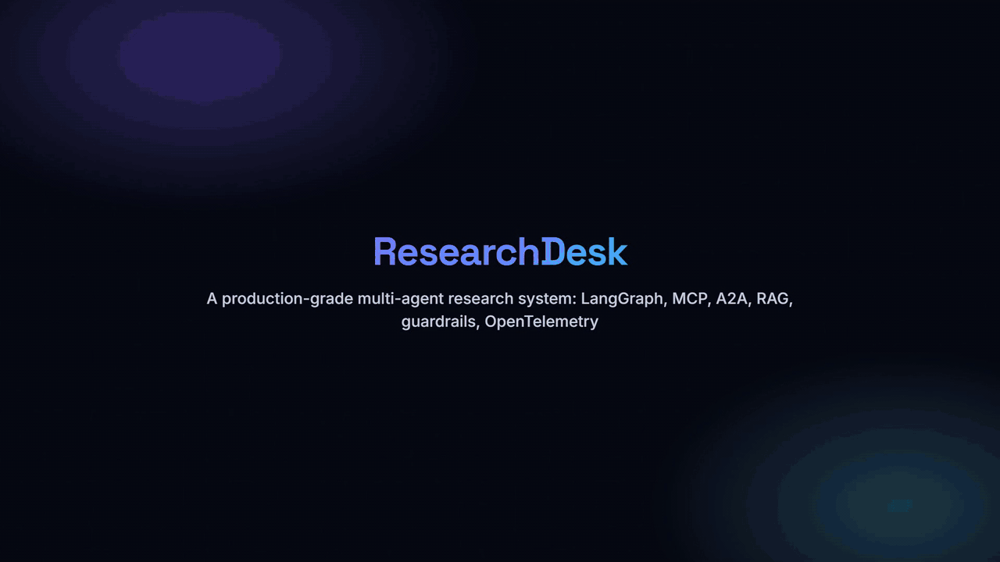

# ResearchDesk

[](https://github.com/izNoGoud1248/ResearchAgent/actions/workflows/ci.yml)

A multi-agent research assistant built to practise production patterns end to end: guardrails, reliability, MCP, A2A, RAG, observability, evaluation and Kubernetes. Everything talks to real services. See `plan.md` for the design and build stages.

The agent workflow is deliberately simple: a planner splits the question, researchers search arXiv in parallel, an independent Fact-Checker verifies each claim against the paper it cites, a writer and critic produce a cited brief, and sensitive briefs wait for a human to approve, revise or reject them. The work is in everything around it.



## Setup

Needs Docker Desktop and uv.

```
uv sync
uv run scripts/initEnv.py
docker compose --profile core up -d --wait
```

`initEnv.py` creates `.env` from `.env.example` and generates the passwords, signing keys and HMAC keys. It never prints them. Add your `OPENAI_API_KEY` to `.env` yourself.

Redis listens on host port 6380 and Postgres on 5433 so they do not clash with other local projects. Change `REDIS_PORT` and `POSTGRES_PORT` in `.env` if needed.

## Running it in containers

```
docker compose --profile app up -d --build --wait
```

Open http://localhost:8088 and sign in with `USER_API_KEY` or `APPROVER_API_KEY`. Add `--profile observability --profile elk` for Jaeger, Kibana and the collector.

One Python image (`Dockerfile`) runs all seven services, each started with its own module through `uv run`, as a non-root user; secrets come from `.env` at runtime and are never in an image. nginx (`services/web`) serves the UI with security headers and forwards `/api` to the API, unbuffered so live events stream. Only the UI (8088) and the API (127.0.0.1:8010, for curl and the evaluation harness) are published. Signing in in the browser exchanges the key for a signed, httpOnly, SameSite=Strict session cookie, so JavaScript never holds a key; `X-Api-Key` still works for scripts. The MCP servers keep the SDK's DNS-rebinding protection on and accept their own container hostnames.

## Testing on local models

To try changes without spending OpenAI tokens, run the agents on models served by [Ollama](https://ollama.com):

```
ollama pull qwen2.5
docker compose -f docker-compose.yml -f docker-compose.ollama.yml --profile app up -d --wait
```

The override points the orchestrator, Fact-Checker and API at Ollama through its OpenAI-compatible endpoint, uses `qwen2.5` for every task and allows 300 seconds per model call and 900 for the Fact-Checker. Run the same command without `-f docker-compose.ollama.yml` to go back to OpenAI. Local calls are recorded with their token counts at zero cost. The paper library still embeds with OpenAI, because its vectors have OpenAI's dimensions; that costs fractions of a cent. Expect slower runs and weaker briefs than with gpt-4o: this mode is for checking that flows work, not for judging quality. Outside containers, set `LLM_BASE_URL=http://localhost:11434/v1`, `CHEAP_MODEL` and `STRONG_MODEL` in the environment.

## Running it on the host (for development)

Stop the `app` containers first; they use the same ports and queue. Then, each in its own terminal:

```
uv run python -m services.mcpSearch
uv run python -m services.mcpNotes
uv run python -m services.mcpLibrary
uv run python -m services.mcpGateway
uv run python -m services.factChecker
uv run python -m services.orchestrator
uv run python -m services.api
```

Ask a question (the key is `USER_API_KEY` from `.env`), then follow it live:

```
curl -X POST localhost:8010/runs -H "X-Api-Key: $KEY" -H "Content-Type: application/json" -d '{"question": "What are the latest approaches to prompt injection defense?", "sensitive": true}'
curl -N localhost:8010/runs/<runId>/events -H "X-Api-Key: $KEY"
```

A sensitive run stops at `awaitingApproval`. Decide with `APPROVER_API_KEY`, using `action` `approve` (save it), `reject` (end it, nothing saved) or `revise` (the note goes back to the writer, the critic scores the new draft, and it returns for approval; at most two rounds, research is not repeated):

```
curl -X POST localhost:8010/runs/<runId>/decision -H "X-Api-Key: $APPROVER_KEY" -H "Content-Type: application/json" -d '{"action": "revise", "note": "Add a section on limitations."}'
```

How it fits together: the API checks the key, the input guard and the rate limit, then queues the run. The orchestrator worker runs the LangGraph graph and checkpoints it in Postgres, so a paused or crashed run continues where it stopped. Agents reach tools only through the gateway (port 8100), which checks each caller's signed token, applies `services/mcpGateway/policy.yaml`, redacts PII both ways, verifies each tool response's HMAC signature and content, and writes every call to the `audit` table. The Fact-Checker is a separate A2A agent with its own keys; it serves its Agent Card at `/.well-known/agent-card.json`.

## Web UI

```
cd services/web
npm install
npm run dev
```

For UI development with hot reload, open http://localhost:5173 and sign in with `USER_API_KEY` or `APPROVER_API_KEY` from `.env`. Vite forwards `/api` to the API on port 8010. Screens: Ask, Live run (agent graph and activity over SSE), Approvals (approvers only), History, Ops and Security. `npm run build` type-checks in strict mode and builds.

## Observability

```
docker compose --profile core --profile observability --profile elk up -d --wait
uv run python -m observability.kibanaSetup
```

`kibanaSetup` also loads two dashboards, defined as code in `observability/dashboards.py`: **ResearchDesk: operations and cost** (runs, outcomes, spend, approvals, tool latency, errors) and **ResearchDesk: security and audit** (gateway decisions, refusal reasons, calls per agent, PII redaction, fact-check verdicts, a drill-down table). Trace ids in their tables open Jaeger and run ids open the run in the app. It also sets a retention policy that deletes log indices after `LOG_RETENTION_DAYS` (30 by default) and pins numeric field types. Run it again after changing a dashboard.

Every run is one trace. The API starts it, the traceparent rides in the queued job to the worker, and every agent, LLM call, MCP call (through the gateway to the tool server) and A2A call to the Fact-Checker joins it. Services write JSON logs with the trace id to `logs/`; Filebeat ships them through Logstash to Elasticsearch (`researchdesk-logs-*`, with gateway audit entries in `researchdesk-audit-*`). Each run page in the UI links to its trace in Jaeger (http://localhost:16686) and its logs in Kibana (http://localhost:5601).

Langfuse is optional: add Langfuse Cloud keys and `LANGFUSE_PROJECT_URL` to `.env`, set `COLLECTOR_CONFIG=collectorLangfuse.yaml`, and restart the collector. LLM spans carry the GenAI and Langfuse attributes, so they show up there as generations under the same trace id. Note that this sends prompts and model output to Langfuse.

The `elk` profile needs about 3 GB of memory for Docker. Elasticsearch runs without security and listens only on 127.0.0.1.

## Evaluation

```
uv run python -m evals.evalHarness
```

Runs the fixed questions in `evals/questions.yaml` through the running system (API, worker, gateway, Fact-Checker), approving any held report, then scores each run: citations that exist on arXiv, reference titles that match the real paper, citations the research never retrieved, fact-check supported rate, critic score, an LLM judge's 1-5 grade, cost and duration. Results go to `evals/results/<pass>.json` and are compared with the previous pass; anything worse than its threshold is flagged as a regression. A pass costs about $0.10 and takes a few minutes, and needs the services running.

## Agent researcher

`libs/harness` is a small agent harness: a tool-calling loop with step, dollar and time budgets, errors fed back to the model, repeat detection, context compaction and hooks, using tools discovered from the MCP gateway. The agent researcher (`services/orchestrator/agents/agentResearcher.py`) uses it to choose its own searches. Pick it per run with `"researcher": "agent"` in `POST /runs`, or by default with `RESEARCHER_MODE=agent`. Compare both with:

```
uv run python -m evals.evalHarness --researcher workflow
uv run python -m evals.evalHarness --researcher agent
```

## Tests

```
uv run pytest -m "not llm"
uv run pytest -m llm -s
```

The first runs against real Redis (database 15, wiped before and after each test), real Postgres and the real arXiv API, at no cost. The second calls the real OpenAI API with gpt-4o-mini and prints what it cost.

## Clarifying unclear questions

Before planning, the Clarifier picks out terms in the question a researcher might not recognise (unusual acronyms, unfamiliar model names, likely typos) and looks each one up on arXiv. The question is then clear, researched under an assumption the brief states, or put back to the user: the run pauses as `awaitingClarification`, the live page shows the question with suggested answers, and `POST /runs/{runId}/clarify` with `{"answer": ...}` resumes it. It asks only when the possible readings would lead to different research, not to have ordinary terms defined.

## Report skills

Report styles live as files in `services/orchestrator/skills/`: each folder has a `SKILL.md` (front matter with a name and description, writing rules, and a `## Checklist`) and a `template.md`. The planner picks a style from the descriptions, the writer follows its rules and template, and the critic scores the draft against its checklist. There are three: a research brief (the default), a comparison report (verdict, a cited comparison table, when to use which) and a literature review (key papers by year, research directions, open problems). Adding a style is adding a folder. The run page shows the style chosen, and Download PDF prints the report alone in a print layout.

The run page also shows the parallel researchers: one row per sub-question with its latest search, tool calls, papers cited and, in agent mode, steps and stop reason.

## Paper library and follow-up questions

Every paper the researchers find goes into a library (`services/mcpLibrary`, Postgres with pgvector). `paper.read` fetches a paper's full text from arXiv's HTML version, splits it by section and embeds it; `library.search` is hybrid search (full-text and vector, merged by reciprocal rank fusion). On a finished report, the follow-up box answers questions from the full text of the papers it cites, citing the section each statement comes from, and flags any citation that was not among the retrieved passages. Paper text passes through the gateway like any tool result, with instruction-like spans neutralized.

## Kubernetes

```
uv run python -m k8s.clusterSetup
uv run python -m k8s.clusterChecks
```

`clusterSetup` builds a local kind cluster (Calico for network policies, KEDA for autoscaling), loads the images, creates the secret from `.env` without printing it and applies `k8s/`. The UI is then on http://localhost:8090. Workers scale from 1 to 4 on the Redis queue length, every pod runs as non-root with a read-only root filesystem, and network policies allow only the connections each service needs. `clusterChecks` tests those policies, a full run, graceful shutdown of a busy worker and scaling under load; pass `network`, `run`, `shutdown` or `scale` to run one. The cluster does not include the paper library yet.

## Roadmap

Ideas for anyone who wants to take this further:

- **Bring your own documents.** Teams upload PDFs and the agents research them alongside arXiv. Each team's documents and passages carry a team id enforced by Postgres row-level security, the team goes into the agent's signed token, and a new gateway tool (`teamDocs.search`) limits search to the caller's team. The agent researcher picks the tool up through gateway discovery with no harness change.
- **Feedback becomes evals.** Users rate reports and flag bad claims; flagged questions join `evals/questions.yaml` so real failures become regression tests.
- **Citation graph.** A Semantic Scholar tool for papers that cite or are cited by a result, so the agent can follow the literature.
- **Model routing and fallback.** A cheap model for easy sub-questions, a stronger one for hard ones, and a second provider when the first is down.
- **Paper library on Kubernetes.** A library deployment, the pgvector image and the network policies it needs.
- **Cloud deployment.** One VM running Docker Compose behind Caddy for HTTPS, without the ELK stack, with an OpenAI spend limit.

## Licence

MIT. See `LICENSE`.
